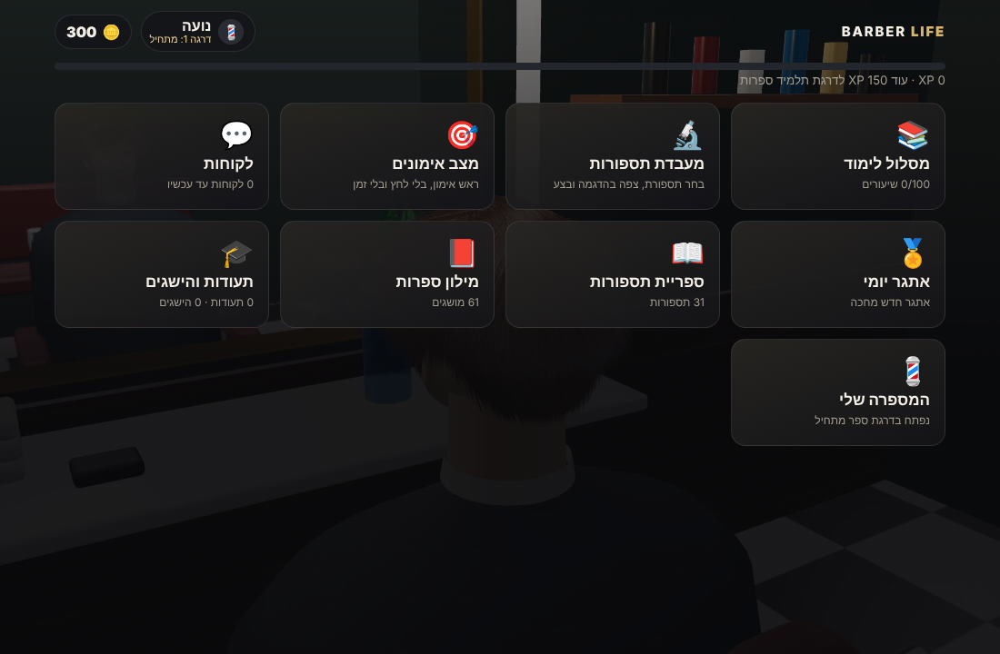
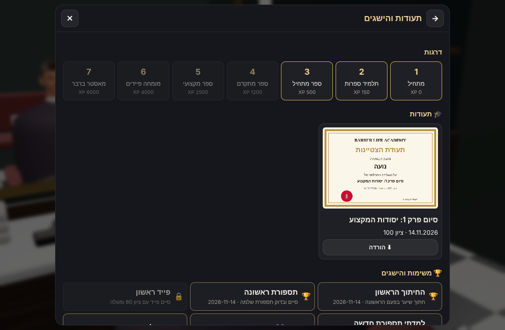
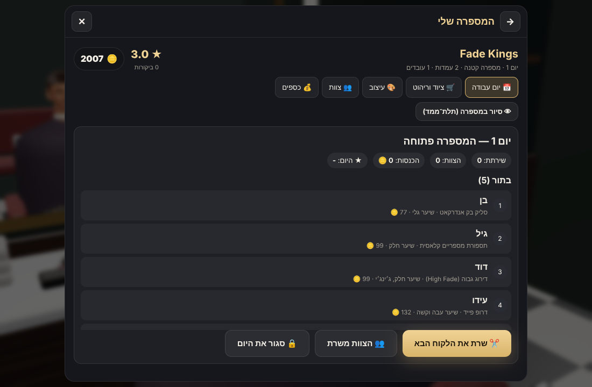
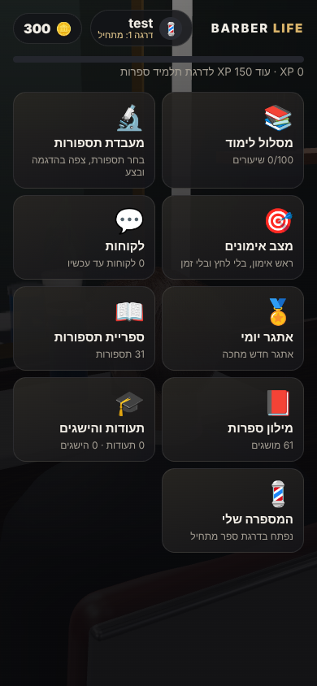
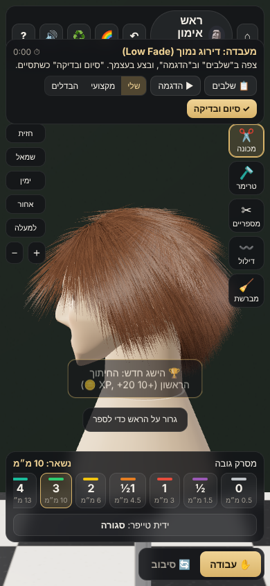

# 💈 BARBER LIFE — אקדמיה וירטואלית לספרות בתלת־ממד

משחק דפדפן (Three.js / WebGL) שבו לומדים להיות ספר מקצועי, מאפס ועד מאסטר ברבר. עובד במחשב ובטלפון (מגע).
פרויקט נפרד בתיקייה הזו. הוא לא נוגע ב־`open-world-game`.

## הרצה

לא צריך להתקין או לבנות כלום. מספיק שרת קבצים סטטי:

```sh
cd barber-life
./tests/serve.sh          # או: python3 -m http.server 8090
# ואז לפתוח http://localhost:8090
```

Three.js כלול בתיקייה `vendor/`, כך שהמשחק לא תלוי באינטרנט חיצוני. לטלפון: מעלים את התיקייה לכל אחסון סטטי
(GitHub Pages, Netlify וכו׳) ופותחים את הכתובת בדפדפן.

## מערכת התספורת התלת־ממדית (הלב של המשחק)

- **לקוח תלת־ממדי** בכיסא ספרים מול מראה אמיתית, או **ראש אימון** על חצובה (חלק, גלי או מתולתל).
- **אלפי שערות תלת־ממדיות** (22,000 במחשב, 13,000 בטלפון), עם קו שיער אמיתי וכיוון צמיחה. שיער קצר עומד, שיער ארוך נשכב, ושיער גלי או מתולתל מסתלסל.
- **הכלים חותכים באמת**, כל שערה בנפרד:
  - **מכונה** עם 9 מסרקי גובה וידית טייפר. הלהב חותך רצועה ישרה, כמו להב אמיתי.
  - **טרימר** לקווים ולעור חלק.
  - **מספריים על מסרק** (8–60 מ״מ), עם גזירה ישרה או פוינט קאט.
  - **מספרי דילול** שמקצרים רק כשליש מהשערות.
  - **מברשת צוואר** שמנקה את השערות מהגלימה.
- שיער קצר מראה את העור שמתחתיו, ולכן פייד נראה כמעבר אמיתי. שערות שנחתכות נופלות על הגלימה ועל הרצפה.
- מצלמה שמסתובבת סביב הראש, זום, מבטים מהירים, מפת אורכים, ביטול ושיער חדש.

## מה יש באקדמיה

| מערכת | מה עושים בה |
| --- | --- |
| 📚 **מסלול לימוד: 100 שיעורים** | 10 פרקים: יסודות, השיער והראש, מכונה, מספריים, פיידים בסיסיים ומתקדמים, קלאסיות, מודרניות, גימור ולקוחות, מאסטר. בכל שיעור יש הסבר בעברית פשוטה, איור, תרגול מעשי ומשימה שנבדקת באמת: שאלות, נגיעה באזור על הראש, בחירת כלי או מסרק, תספורת מלאה או לקוח. שיעור נפתח רק אחרי שעוברים את הקודם, ואפשר לחזור על כל שיעור. השיעור האחרון בכל פרק הוא מבחן שנותן תעודה. |
| 🔬 **מעבדת תספורות** | בוחרים תספורת, רואים את התוצאה המקצועית מ־4 צדדים, קוראים את השלבים, צופים ב**הדגמה תלת־ממדית שחותכת באמת**, ואז מבצעים בעצמך. |
| 🎯 **מצב אימונים** | ראש אימון בלי זמן ובלי לחץ. אפשר לחזור על תספורות שלמדת, או לעבוד באימון חופשי שנשמר אוטומטית. |
| 💬 **לקוחות** | כל לקוח מסביר במילים שלו מה הוא רוצה ("דירוג נמוך, להשאיר אורך למעלה ולסדר את הפוני"), ולפעמים מראה תמונה. השחקן עונה "מה הלקוח ביקש?", מחטא כלים, מספר, ומנקה את הלקוח בסוף. הלקוח נותן משוב לפי אופי (רגוע, רגיל או קפדן), כוכבים ותשלום. |
| 🧑‍🏫 **מורה אישי** | אחרי כל תספורת: מה עשית טוב, מה פחות טוב, איפה בדיוק היו טעויות ("קו חד בצד ימין, בקו הרקה: קפיצה מ־3 ל־4.5 מ״מ"), איך לתקן, ואיזה שיעור כדאי ללמוד הבא. אפשר "להמשיך לתקן" ולבדוק שוב. |
| 🔍 **השוואה למקצועי** | "שלי / מקצועי / הבדלים" על אותו ראש: ירוק = אורך נכון, אדום = ארוך מדי, כחול = קצר מדי. כולל טבלת אורכים לפי אזור. |
| 📖 **ספריית תספורות** | 31 תספורות: פיידים (טייפר, נמוך, אמצעי, גבוה, סקין, בולד, דרופ...), קלאסיות (באז, קרו, קיסר, אייבי ליג, שביל צד, פלאט טופ...) ומודרניות (פרנץ׳ קרופ, אנדרקאט, קוויף, פומפדור, אדגר...). לכל אחת יש תיאור, רמת קושי, תמונות מכל הצדדים, שלבים ושיעור במסלול. |
| 📕 **מילון ספרות** | 61 מושגים בעברית ובאנגלית, עם הסבר פשוט, איור וחיפוש. מושגים של אזורים בראש מסומנים בזהב על הראש התלת־ממדי. |
| 🏅 **אתגר יומי, משימות ותעודות** | אתגר חדש כל יום, 16 הישגים ומשימות, 7 דרגות (מתחיל ← מאסטר ברבר), ותעודות שאפשר להוריד כתמונה. |
| 💈 **המספרה שלי** | נפתחת בדרגת "ספר מתחיל". כוללת שם, עיצוב (קירות, ריצפה, עור כיסאות), וקנייה של כיסאות, מראת LED, ספה, מכונת קפה, שלט ניאון, תאורה, ארון חיטוי ומכונות מקצועיות (שמשפרות את החיתוך). לכל פריט יש שם, תיאור, מחיר ודירוג. אפשר להרחיב את המספרה, להעסיק ספרים, לנהל יום עבודה עם תור לקוחות, לראות הכנסות והוצאות, רווח ומוניטין, ולסייר במספרה בתלת־ממד. |

## בדיקת איכות אמיתית

הציון מחושב על השערות עצמן, לא על הכפתורים שנלחצו. לכל תספורת יש **יעד: אורך לכל נקודה בקרקפת**, והבדיקה משווה אליו:

- **דיוק האורך**: לפי אזורים קטנים בראש. שיער קצר מדי נענש יותר, כי אי אפשר לתקן אותו.
- **סימטריה**: משווה כל אזור בצד ימין לאזור המקביל בצד שמאל.
- **מעברים**: בכל עמודה מלמטה למעלה בודקים שהשינוי באורך עוקב אחרי היעד, וכך מזהים קווים חדים.
- **אחידות**: איים של שיער שהכלי פספס.
- **גימור וניקיון**: קווי מתאר (עורף, פאות ואוזניים), שערות על הגלימה, וחיטוי הכלים.
- **התאמה לבקשה**: מול הבקשות הספציפיות של הלקוח.

שיער שלא נגעו בו מקבל ציון נמוך, כי סימטריה ואחידות נספרות רק כשהעבודה באמת נעשתה. ההדגמה המקצועית מקבלת כ־95.

## שליטה

| פעולה | מחשב | טלפון |
| --- | --- | --- |
| עבודה עם כלי | גרירה עם כפתור שמאלי על הראש | גרירה באצבע על הראש |
| סיבוב מצלמה | גרירה מחוץ לראש / כפתור ימני / חיצים | גרירה מחוץ לראש, מצב "🔄 סיבוב", או שתי אצבעות |
| זום | גלגלת | צביטה, או ＋/－ |
| מסרק | מקשים 0–8 | כפתורי המסרקים |
| ביטול | Ctrl+Z | ↶ |
| מפת אורכים / החלפת מכונה וטרימר | M / T | 🌈 / לוח הכלים |

## צילומי מסך

| | |
| --- | --- |
|  |  |
|  |  |
|  |  |
|  |  |
|  |  |

## מבנה הקוד

```
barber-life/
  index.html, css/style.css
  js/main.js                 מנוע: רינדור, ראש ושיער, חיתוך, כלים, קלט, ממשק בסיס
  js/hair/scalp.js           גיאומטריית הראש, קו שיער, אזורים
  js/hair/hairSystem.js      שערות תלת־ממדיות (instancing + shader), חיתוך, דילול, יעד, מפות
  js/hair/clippings.js       שיער שנופל, גלימה, מברשת
  js/scene/client.js         לקוח / ראש אימון
  js/scene/shop.js           החדר, הכיסא, המראה, תאורה
  js/scene/shopDecor.js      מה שנקנה ועוצב, בתלת־ממד
  js/tools/tools.js          מכונה, מסרקים, טרימר, מספריים, דילול, מברשת
  js/data/haircuts.js        ספריית התספורות (יעדים, שלבים, איורים)
  js/data/lessons.js         100 השיעורים
  js/data/dictionary.js      המילון
  js/data/clients.js         לקוחות, בקשות ומשוב
  js/game/analysis.js        בדיקת האיכות והמורה האישי
  js/game/demo.js            הדגמה תלת־ממדית
  js/game/session.js         סשן תספורת: משימה, שלבים, השוואה, תוצאות
  js/game/progress.js        התקדמות, דרגות, הישגים, תעודות, שמירה
  js/game/shopManager.js     המספרה שלי
  js/ui/screens.js           תפריטים ומסכים
  js/ui/illustrations.js     איורים
  tests/smoke.mjs            בדיקה אוטומטית (70 בדיקות, Playwright)
```

### בדיקות

```sh
./tests/serve.sh &
node tests/smoke.mjs [screenshotDir]
```

## היגיינה ובטיחות

המשחק מדגיש חיטוי כלים לפני כל לקוח, צווארון נייר, ניקוי הלקוח ועבודה זהירה ליד האוזניים והעורף.
התרגול נעשה כאן בסימולציה. עבודה אמיתית עם כלים חדים נעשית רק בהדרכה ובהשגחה מתאימה.
