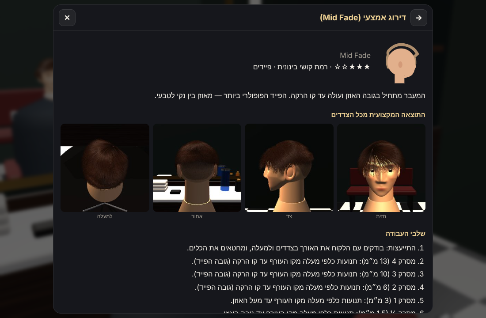
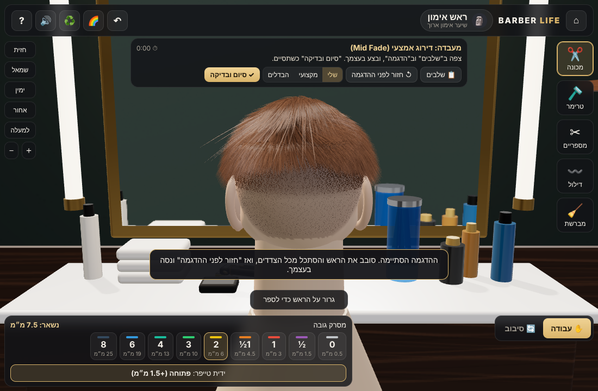
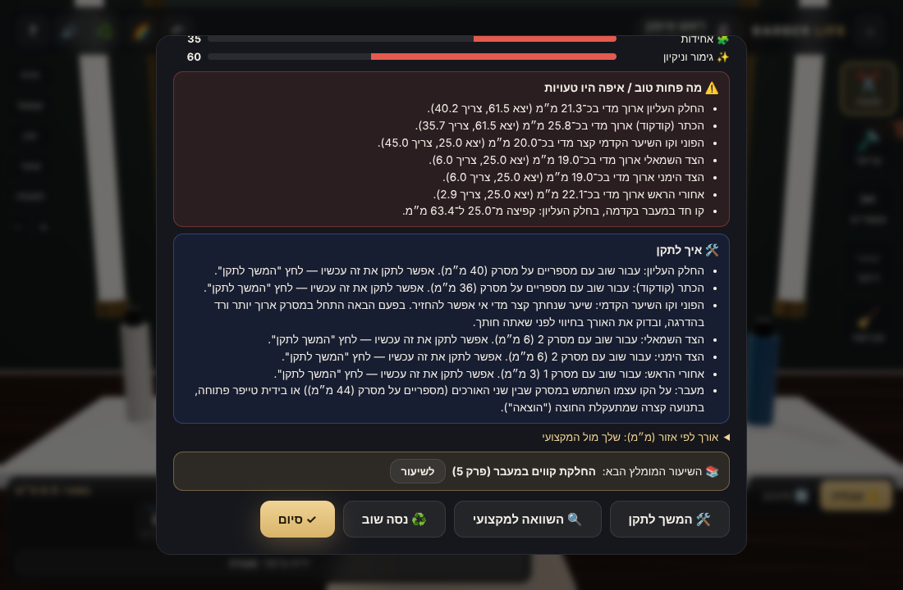
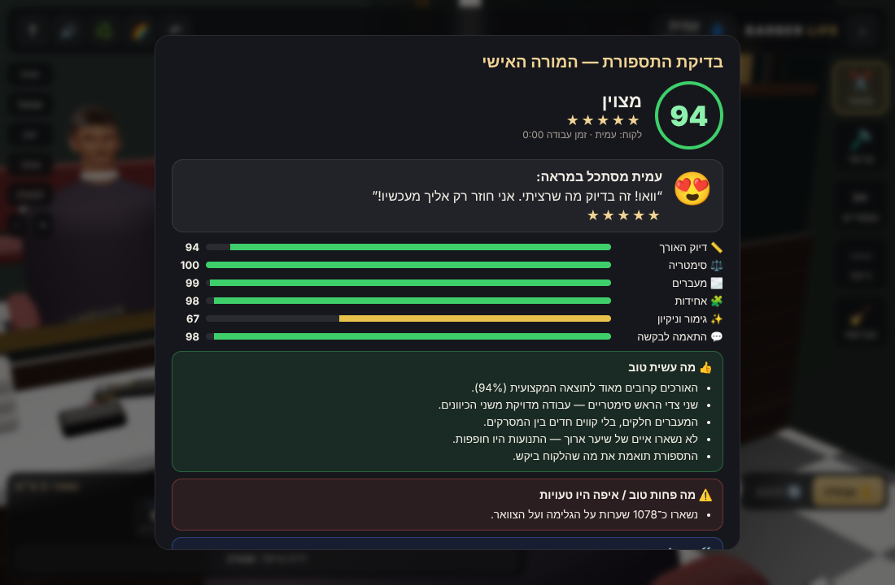
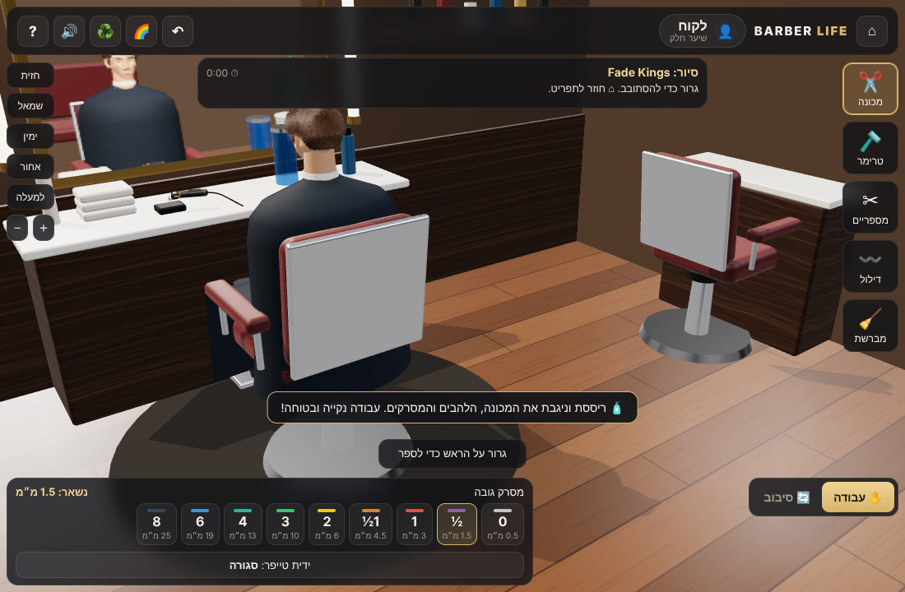

# 💈 BARBER LIFE — אקדמיה וירטואלית לספרות בתלת־ממד

משחק דפדפן (Three.js / WebGL) שבו לומדים להיות ספר מקצועי, מאפס ועד מאסטר ברבר. עובד במחשב ובטלפון (מגע).
פרויקט נפרד בתיקייה הזו. הוא לא נוגע ב־`open-world-game`.

## הרצה

לא צריך להתקין או לבנות כלום. מספיק שרת קבצים סטטי:

```sh
cd barber-life
./tests/serve.sh          # או: python3 -m http.server 8090
# ואז לפתוח http://localhost:8090
```

Three.js כלול בתיקייה `vendor/`, כך שהמשחק לא תלוי באינטרנט חיצוני. לטלפון: מעלים את התיקייה לכל אחסון סטטי
(GitHub Pages, Netlify וכו׳) ופותחים את הכתובת בדפדפן.

## 🏙️ עולם פתוח: החיים של ספר בעיר

המשחק מתחיל בעיר תלת־ממדית אמיתית שמסתובבים בה ברגל או ברכב:

- **עיר של 4×4 רחובות:** כבישים עם מעברי חצייה, מדרכות, עצים ופנסים, בניינים עם חלונות שנדלקים בלילה, פארק עם מזרקה, ומפה מלאה ומפה קטנה עם סימון יעד.
- **יום ולילה ומזג אוויר:** שנייה אמיתית = 2 דקות במשחק. השמש זזה, הפנסים נדלקים, ובכל יום מזג אוויר אחר: בהיר, מעונן או גשום (בגשם יש פחות לקוחות).
- **אנשים ותנועה:** תושבים הולכים על המדרכות, נכנסים לעסקים ויוצאים, ואפשר לדבר איתם ולקבל טיפים. מכוניות נוסעות בנתיב הימני ועוצרות להולכי רגל.
- **מבנים שנכנסים אליהם באמת**, בלי מסך טעינה: האקדמיה, 3 מספרות, משרד נדל״ן, 6 חנויות להשכרה או למכירה, 3 דירות, חנות בגדים, בית קפה וסוכנות רכב.

### מסלול הקריירה (7 שלבים)
תלמיד ספרות ← ספר מתחיל ← ספר שעובד במספרה ← ספר מקצועי ← בעל מספרה קטנה ← בעל מספרה מצליחה ← בעל רשת מספרות.
שורת **🎯 המטרה** בראש המסך תמיד אומרת מה הצעד הבא, כדי שלא יהיה בלאגן.

1. **לומדים באקדמיה:** ניגשים למזכירה, וכל מה שהיה קיים (100 השיעורים, המעבדה, האימונים, הספרייה, המילון והאתגר היומי) נמצא שם. כל שיעור לוקח זמן מהיום.
2. **עובדים אצל אחרים:** מדברים עם בעל מספרה (Fade House למתחילים, Classic Cuts, Royal Barbers למקצוענים). לקוחות נכנסים מהרחוב ומתיישבים. ניגשים לכיסא ומספרים באמת, ומקבלים עמלה לפי איכות העבודה, טיפים ומשכורת בסיס. יש משוב מהבוס, קידום בעמלה, ואזהרות אם העבודה חלשה.
3. **חוסכים:** בחצות יורדים שכירות הדירה וההוצאות, ומקבלים סיכום יומי. צריך גם לנהל אנרגיה: לישון בבית ולאכול בקפה.
4. **נדל״ן:** משרד הנדל״ן מציג נכסים ודירות. נכנסים לנכס, בודקים את הגודל, המיקום, תנועת הלקוחות, השכירות והמחיר, וחותמים על חוזה שכירות (פיקדון) או קונים.
5. **מספרה משלך:** קונים כיסאות וציוד, בוחרים שם (מופיע על השלט), צבעים וריהוט. לקוחות מגיעים לבד בשעות הפתיחה (9:00–19:00) לפי המיקום והדירוג. אתה מספר בכיסא הראשון, העובדים בשאר הכיסאות.
6. **בעל עסק:** מגייסים ספרים וקובעים משכורת ועמלה, שמשפיעות על מצב הרוח (עובד לא מרוצה עוזב). יש ביקורות ודירוג, לקוחות חוזרים שממליצים לחברים, ולקוח לא מרוצה לא חוזר. ספר כספים יומי ומסך "העסק שלי" לכל הסניפים, ושלוש מספרות הן רשת.
7. **החיים:** קונים בגדים וסינר עבודה, עוברים לדירה גדולה יותר, קונים קטנוע או רכב ונוסעים בעיר.

## 🎮 חוויית משחק: הדרכה, משימות, שליטה ותחושה

- **הדרכה אינטראקטיבית ב־10 שלבים** בכניסה הראשונה: תנועה, מפה, שיחה עם אנשים, כניסה למספרה, מציאת עבודה, לימוד באקדמיה, מכונה ומספריים בסימולציה, לקוח אמיתי, כסף (טלפון), ומשרד הנדל״ן. בכל שלב: הסבר קצר, חץ ומסגרת זוהרת על הכפתור הנכון, GPS לנקודה בעיר, מעבר לשלב הבא רק כשהפעולה בוצעה באמת, ורמז ספציפי כשטועים (בניין לא נכון, כלי לא נכון, מספרה סגורה...). אפשר לדלג או להפעיל שוב מההגדרות.
- **יומן משימות** (12 משימות סיפור): מה לעשות, לאן ללכת, התקדמות, פרס (XP + מטבעות) ומה הבא. **GPS**: חץ זהב ליד הרגליים, עמוד אור ביעד, וחץ עם מרחק בראש המסך.
- **שליטה**: ג׳ויסטיק, קפיצה, ריצה, כפתור פעולה שמשתנה לפי מה שקרוב, סיבוב מצלמה באצבע, מפה, טלפון והגדרות. בהגדרות: גודל הכפתורים, מצב שמאליים, גרירת הכפתורים למקום חדש, צלילים, מוזיקה ועוצמה. במחשב: WASD, Shift, רווח, E, M, P, Q.
- **אנימציות**: דמויות עם ברכיים ומרפקים (הליכה, ריצה, קפיצה, ישיבה), דלתות זכוכית נפתחות, כניסה ויציאה מרכב, ספרים שעובדים על לקוחות, לקוח שמסתכל במראה, משלם בדלפק ומטבע עולה, יד בכפפה שמחזיקה את המכונה.
- **תחושה**: אפקט לחיצה וצליל לכל כפתור, מוזיקת רקע (עיר / מספרה / לילה), מטבעות שעפים לארנק, באנר הצלחה וקונפטי, מעברים חלקים.
- **פרופיל**: רמה ו־XP, קריירה, סטטיסטיקות, משימות, מספרות פתוחות, ציוד, נכסים והישגים.
- **שמירה**: כסף, מספרות, ציוד, משימות, הדרכה, דרגה ומיקום — אוטומטית, וגם כשסוגרים את האפליקציה.

## מערכת התספורת התלת־ממדית (הלב של המשחק)

- **לקוח תלת־ממדי** בכיסא ספרים מול מראה אמיתית, או **ראש אימון** על חצובה (חלק, גלי או מתולתל).
- **אלפי שערות תלת־ממדיות** (22,000 במחשב, 13,000 בטלפון), עם קו שיער אמיתי וכיוון צמיחה. שיער קצר עומד, שיער ארוך נשכב, ושיער גלי או מתולתל מסתלסל.
- **הכלים חותכים באמת**, כל שערה בנפרד:
  - **מכונה** עם 9 מסרקי גובה וידית טייפר. הלהב חותך רצועה ישרה, כמו להב אמיתי.
  - **טרימר** לקווים ולעור חלק.
  - **מספריים על מסרק** (8–60 מ״מ), עם גזירה ישרה או פוינט קאט.
  - **מספרי דילול** שמקצרים רק כשליש מהשערות.
  - **מברשת צוואר** שמנקה את השערות מהגלימה.
- שיער קצר מראה את העור שמתחתיו, ולכן פייד נראה כמעבר אמיתי. שערות שנחתכות נופלות על הגלימה ועל הרצפה.
- מצלמה שמסתובבת סביב הראש, זום, מבטים מהירים, מפת אורכים, ביטול ושיער חדש.

## מה יש באקדמיה

| מערכת | מה עושים בה |
| --- | --- |
| 📚 **מסלול לימוד: 100 שיעורים** | 10 פרקים: יסודות, השיער והראש, מכונה, מספריים, פיידים בסיסיים ומתקדמים, קלאסיות, מודרניות, גימור ולקוחות, מאסטר. בכל שיעור יש הסבר בעברית פשוטה, איור, תרגול מעשי ומשימה שנבדקת באמת: שאלות, נגיעה באזור על הראש, בחירת כלי או מסרק, תספורת מלאה או לקוח. שיעור נפתח רק אחרי שעוברים את הקודם, ואפשר לחזור על כל שיעור. השיעור האחרון בכל פרק הוא מבחן שנותן תעודה. |
| 🔬 **מעבדת תספורות** | בוחרים תספורת, רואים את התוצאה המקצועית מ־4 צדדים, קוראים את השלבים, צופים ב**הדגמה תלת־ממדית שחותכת באמת**, ואז מבצעים בעצמך. |
| 🎯 **מצב אימונים** | ראש אימון בלי זמן ובלי לחץ. אפשר לחזור על תספורות שלמדת, או לעבוד באימון חופשי שנשמר אוטומטית. |
| 💬 **לקוחות** | כל לקוח מסביר במילים שלו מה הוא רוצה ("דירוג נמוך, להשאיר אורך למעלה ולסדר את הפוני"), ולפעמים מראה תמונה. השחקן עונה "מה הלקוח ביקש?", מחטא כלים, מספר, ומנקה את הלקוח בסוף. הלקוח נותן משוב לפי אופי (רגוע, רגיל או קפדן), כוכבים ותשלום. |
| 🧑‍🏫 **מורה אישי** | אחרי כל תספורת: מה עשית טוב, מה פחות טוב, איפה בדיוק היו טעויות ("קו חד בצד ימין, בקו הרקה: קפיצה מ־3 ל־4.5 מ״מ"), איך לתקן, ואיזה שיעור כדאי ללמוד הבא. אפשר "להמשיך לתקן" ולבדוק שוב. |
| 🔍 **השוואה למקצועי** | "שלי / מקצועי / הבדלים" על אותו ראש: ירוק = אורך נכון, אדום = ארוך מדי, כחול = קצר מדי. כולל טבלת אורכים לפי אזור. |
| 📖 **ספריית תספורות** | 31 תספורות: פיידים (טייפר, נמוך, אמצעי, גבוה, סקין, בולד, דרופ...), קלאסיות (באז, קרו, קיסר, אייבי ליג, שביל צד, פלאט טופ...) ומודרניות (פרנץ׳ קרופ, אנדרקאט, קוויף, פומפדור, אדגר...). לכל אחת יש תיאור, רמת קושי, תמונות מכל הצדדים, שלבים ושיעור במסלול. |
| 📕 **מילון ספרות** | 61 מושגים בעברית ובאנגלית, עם הסבר פשוט, איור וחיפוש. מושגים של אזורים בראש מסומנים בזהב על הראש התלת־ממדי. |
| 🏅 **אתגר יומי, משימות ותעודות** | אתגר חדש כל יום, 16 הישגים ומשימות, 7 דרגות (מתחיל ← מאסטר ברבר), ותעודות שאפשר להוריד כתמונה. |
| 💈 **המספרה שלי** | נפתחת בדרגת "ספר מתחיל". כוללת שם, עיצוב (קירות, ריצפה, עור כיסאות), וקנייה של כיסאות, מראת LED, ספה, מכונת קפה, שלט ניאון, תאורה, ארון חיטוי ומכונות מקצועיות (שמשפרות את החיתוך). לכל פריט יש שם, תיאור, מחיר ודירוג. אפשר להרחיב את המספרה, להעסיק ספרים, לנהל יום עבודה עם תור לקוחות, לראות הכנסות והוצאות, רווח ומוניטין, ולסייר במספרה בתלת־ממד. |

## בדיקת איכות אמיתית

הציון מחושב על השערות עצמן, לא על הכפתורים שנלחצו. לכל תספורת יש **יעד: אורך לכל נקודה בקרקפת**, והבדיקה משווה אליו:

- **דיוק האורך**: לפי אזורים קטנים בראש. שיער קצר מדי נענש יותר, כי אי אפשר לתקן אותו.
- **סימטריה**: משווה כל אזור בצד ימין לאזור המקביל בצד שמאל.
- **מעברים**: בכל עמודה מלמטה למעלה בודקים שהשינוי באורך עוקב אחרי היעד, וכך מזהים קווים חדים.
- **אחידות**: איים של שיער שהכלי פספס.
- **גימור וניקיון**: קווי מתאר (עורף, פאות ואוזניים), שערות על הגלימה, וחיטוי הכלים.
- **התאמה לבקשה**: מול הבקשות הספציפיות של הלקוח.

שיער שלא נגעו בו מקבל ציון נמוך, כי סימטריה ואחידות נספרות רק כשהעבודה באמת נעשתה. ההדגמה המקצועית מקבלת כ־95.

## שליטה

| פעולה | מחשב | טלפון |
| --- | --- | --- |
| עבודה עם כלי | גרירה עם כפתור שמאלי על הראש | גרירה באצבע על הראש, או **משטח כיוון 🎯**: גוררים במשטח בצד המסך כדי להזיז כוונת על הראש ומחזיקים ✂️ כדי לספר (לחיצה קצרה נועלת חיתוך) — האצבע לא מסתירה את הראש |
| סיבוב מצלמה | גרירה מחוץ לראש / כפתור ימני / חיצים | גרירה מחוץ לראש, מצב "🔄 סיבוב", או שתי אצבעות |
| זום | גלגלת | צביטה, או ＋/－ |
| מסרק | מקשים 0–8 | כפתורי המסרקים |
| ביטול | Ctrl+Z | ↶ |
| מפת אורכים / החלפת מכונה וטרימר | M / T | 🌈 / לוח הכלים |

## צילומי מסך

| | |
| --- | --- |
|  |  |
|  |  |
|  |  |
|  |  |
|  |  |

## מבנה הקוד

```
barber-life/
  index.html, css/style.css
  js/main.js                 מנוע: רינדור, ראש ושיער, חיתוך, כלים, קלט, ממשק בסיס
  js/hair/scalp.js           גיאומטריית הראש, קו שיער, אזורים
  js/hair/hairSystem.js      שערות תלת־ממדיות (instancing + shader), חיתוך, דילול, יעד, מפות
  js/hair/clippings.js       שיער שנופל, גלימה, מברשת
  js/scene/client.js         לקוח / ראש אימון
  js/scene/shop.js           החדר, הכיסא, המראה, תאורה
  js/scene/shopDecor.js      מה שנקנה ועוצב, בתלת־ממד
  js/tools/tools.js          מכונה, מסרקים, טרימר, מספריים, דילול, מברשת
  js/data/haircuts.js        ספריית התספורות (יעדים, שלבים, איורים)
  js/data/lessons.js         100 השיעורים
  js/data/dictionary.js      המילון
  js/data/clients.js         לקוחות, בקשות ומשוב
  js/game/analysis.js        בדיקת האיכות והמורה האישי
  js/game/demo.js            הדגמה תלת־ממדית
  js/game/session.js         סשן תספורת: משימה, שלבים, השוואה, תוצאות
  js/game/progress.js        התקדמות, דרגות, הישגים, תעודות, שמירה
  js/game/shopManager.js     המספרה שלי
  js/ui/screens.js           תפריטים ומסכים
  js/ui/illustrations.js     איורים
  js/world/worldData.js      העיר: רחובות, מקומות, מספרות, נכסים, דירות, רכבים, קריירה
  js/world/cityBuilder.js    בניית העיר והפנים של המבנים
  js/world/worldMode.js      הליכה ונהיגה, מצלמה, שליטה, התנגשויות, מפות
  js/world/people.js / npcs.js  אנשים ותושבים
  js/world/traffic.js        תנועה בכבישים
  js/world/sky.js            יום ולילה ומזג אוויר
  js/world/life.js           זמן, כסף, קריירה, עבודה, דירה, קפה, בגדים, רכב
  js/world/business.js       נדל״ן, המספרות שלך, עובדים, ביקורות, רשת
  js/world/quests.js         יומן משימות ו־GPS
  js/world/tutorial.js       ההדרכה האינטראקטיבית
  js/world/controls.js       הגדרות שליטה וצליל
  js/core/sfx.js             צלילים ומוזיקה מסונתזים
  js/ui/fx.js                אפקטים: לחיצה, מטבעות, באנרים, מעברים
  js/ui/profile.js           פרופיל השחקן
  tests/smoke.mjs            בדיקה אוטומטית של כל המערכות (Playwright)
  tests/ux.mjs               משחק את כל ההדרכה בטלפון לרוחב עם לחיצות אמיתיות
```

### בדיקות

```sh
./tests/serve.sh &
node tests/smoke.mjs [screenshotDir]
node tests/ux.mjs [screenshotDir]
```

## היגיינה ובטיחות

המשחק מדגיש חיטוי כלים לפני כל לקוח, צווארון נייר, ניקוי הלקוח ועבודה זהירה ליד האוזניים והעורף.
התרגול נעשה כאן בסימולציה. עבודה אמיתית עם כלים חדים נעשית רק בהדרכה ובהשגחה מתאימה.
