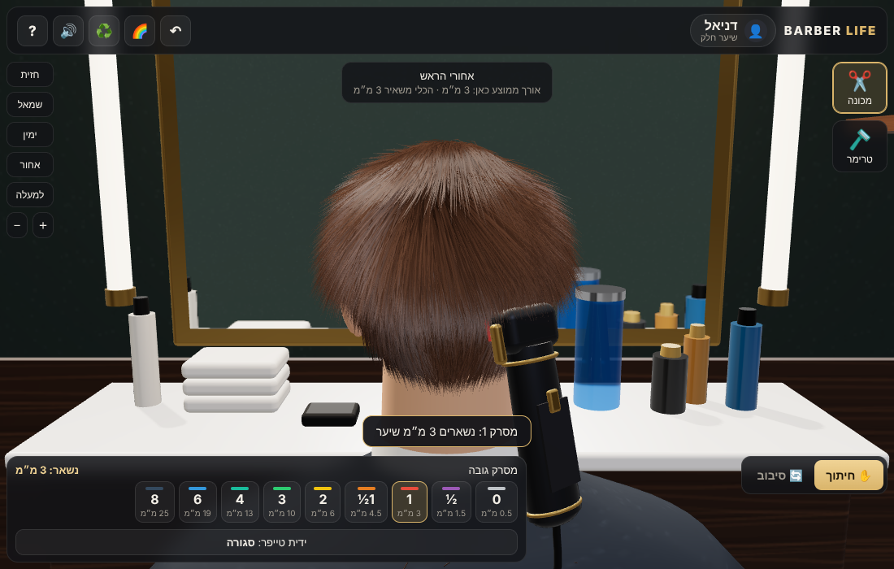
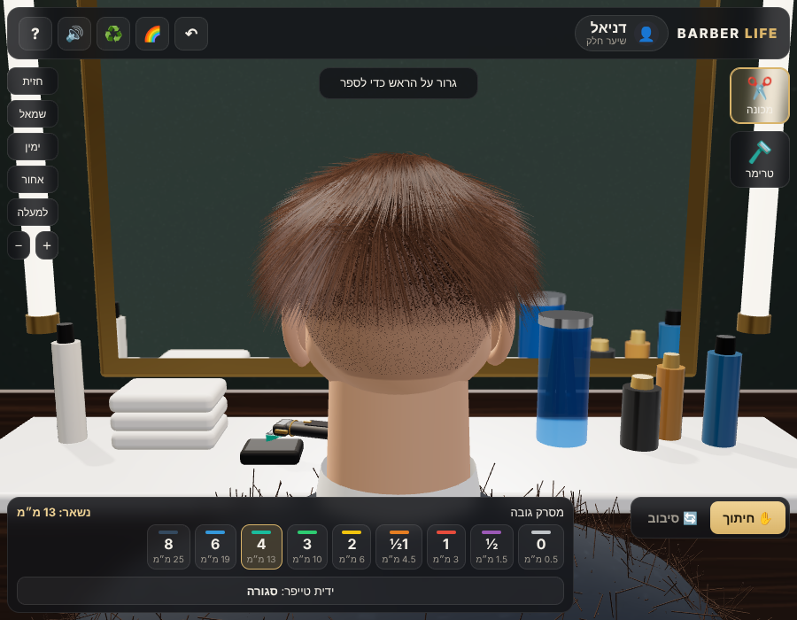
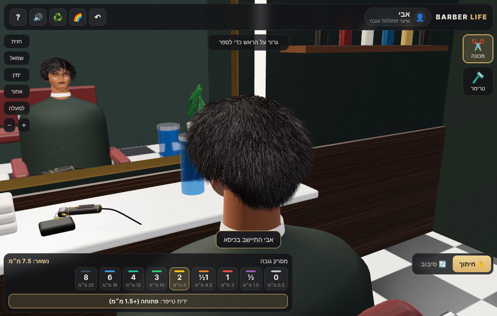
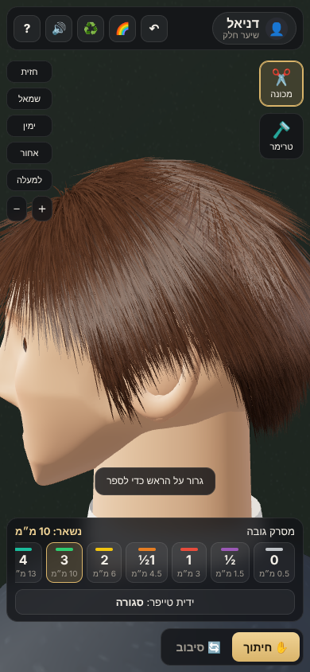

# 💈 BARBER LIFE — משחק לימוד ספרות בתלת־ממד

משחק דפדפן (Three.js / WebGL) שבו לומדים להיות ספר מקצועי, שלב אחרי שלב. עובד במחשב ובטלפון (מגע).
פרויקט נפרד בתיקייה הזו. הוא לא נוגע ב־`open-world-game`.

## הרצה

לא צריך להתקין או לבנות כלום. מספיק שרת קבצים סטטי:

```sh
cd barber-life
./tests/serve.sh          # או: python3 -m http.server 8090
# ואז לפתוח http://localhost:8090
```

Three.js כלול בתיקייה `vendor/`, כך שהמשחק לא תלוי באינטרנט חיצוני. לטלפון: מעלים את התיקייה לכל אחסון סטטי
(GitHub Pages, Netlify וכו׳) ופותחים את הכתובת בדפדפן.

## שלב 1 (הגרסה הזו): עמדת אימון ותספורת תלת־ממדית אמיתית

- **לקוח תלת־ממדי** יושב בכיסא ספרים מול מראה אמיתית (משקפת את החדר בזמן אמת). הראש מפוסל: פנים, עיניים עם עפעפיים, אוזניים, צוואר, גלימת ספרים וצווארון נייר.
- **שיער מאלפי שערות תלת־ממדיות** (22,000 במחשב, 13,000 בטלפון). כל שערה צומחת מנקודה משלה על הקרקפת, עם קו שיער אמיתי (מצח, מפרצים, פאות, קשת מעל האוזן, עורף) וכיוון צמיחה (כולל "סחרור" בכתר).
  שיער קצר עומד, שיער ארוך נשכב ועוקב אחרי צורת הראש, ושיער גלי או מתולתל מסתלסל. אין כאן תמונה שטוחה של שיער.
- **חיתוך אמיתי**: כל שערה שהמכונה עוברת מעליה מתקצרת לאורך שהמסרק משאיר. הקצוות של הלהב חותכים רק חלק מהשערות, כמו להב אמיתי.
  ככל שהשיער קצר יותר, העור נראה דרכו (צל של זיפים), ולכן פייד נראה כמעבר הדרגתי מעור לשיער.
- **שיער שנופל**: השערות שנחתכו נופלות, מחליקות על הגלימה ומצטברות על הרצפה.
- **מכונת תספורת** עם 9 מסרקי גובה (0 / ½ / 1 / 1½ / 2 / 3 / 4 / 6 / 8, מ־0.5 עד 25 מ״מ) וידית טייפר (+1.5 מ״מ). המסרק מוחלף גם על המודל התלת־ממדי.
- **טרימר** (מכונת פיניש) צר ומדויק לקווים: מסביב לאוזן, פאות ועורף.
- **מצלמה**: מסתובבים סביב הראש, מתקרבים ומתרחקים, ויש כפתורי מבט מהירים (חזית / שמאל / ימין / אחור / למעלה).
- **🌈 מפת אורכים**: צובעת כל שערה לפי האורך שלה, כדי לבדוק מעברים וסימטריה.
- **חיווי**: מראה מעל איזה אזור בראש עובדים (כתר, צד ימין, עורף, פאה...) ומה האורך הממוצע שם.
- **↶ ביטול** של עד 20 תנועות, **♻️ שיער חדש**, ו־3 לקוחות לאימון: שיער חלק, גלי ומתולתל עבה.
- **שמירה אוטומטית** (localStorage): מצב השיער של כל לקוח, הכלי, המסרק וההגדרות.
- **צליל מכונה** שנוצר בקוד, עם "קראנץ׳" כשחותכים שיער בפועל.

### צילומי מסך

| | |
| --- | --- |
|  |  |
|  |  |

### שליטה

| פעולה | מחשב | טלפון |
| --- | --- | --- |
| חיתוך | גרירה עם כפתור שמאלי על הראש | גרירה באצבע על הראש |
| סיבוב מצלמה | גרירה מחוץ לראש / כפתור ימני / חיצים | גרירה מחוץ לראש, או מצב "🔄 סיבוב", או שתי אצבעות |
| זום | גלגלת | צביטה, או ＋/－ |
| מסרק | מקשים 0–8 | כפתורי המסרקים |
| ביטול | Ctrl+Z | ↶ |
| מפת אורכים / החלפת כלי | M / T | 🌈 / כפתורי הכלים |

## סדר הפיתוח (השלבים הבאים)

1. ✅ לקוח, כיסא, מכונה וחיתוך שיער אמיתי (הגרסה הזו)
2. מספריים ומסרק (Scissor-over-comb, אצבעות), מייבש שיער ועיצוב
3. בית הספר: שיעורים 1–7 עם הדגמה, הוראות בעברית, תרגול, מבחני ידע וחזרה על שיעורים
4. תספורות יעד (פיידים, Buzz, Crew, French Crop...) עם השוואה לתוצאה מקצועית וציון: דיוק, סימטריה, אחידות, התאמה, גימור וניקיון
5. לקוחות עם בקשות ("Mid Fade עם קצת אורך למעלה"), תמונת רפרנס ומשוב במראה
6. יצירת דמות, רמות (מתחיל ← מאסטר ברבר), ציוד לקנייה ושדרוג
7. מספרה משלך, כלכלה, מוניטין, עובדים, משימות ואתגרים

## מבנה הקוד

```
barber-life/
  index.html, css/style.css
  js/main.js              אתחול, לולאה, קלט, ממשק, שמירה
  js/hair/scalp.js        גיאומטריית הראש: אליפסואיד, קו שיער, אזורים
  js/hair/hairSystem.js   שערות תלת־ממדיות (instancing + shader), חיתוך, צל זיפים, שמירה
  js/hair/clippings.js    שיער שנחתך ונופל
  js/scene/client.js      הלקוח: ראש מפוסל, פנים, אוזניים, גלימה
  js/scene/shop.js        החדר, הכיסא, המראה, התאורה
  js/tools/tools.js       מכונה, מסרקים, ידית טייפר, טרימר
  js/core/orbitCam.js     מצלמה
  js/core/audio.js        צליל המכונה
  tests/smoke.mjs         בדיקה אוטומטית (Playwright)
```

### בדיקות

```sh
./tests/serve.sh &
node tests/smoke.mjs [screenshotDir]
```

## היגיינה ובטיחות

המשחק מדגיש ניקוי וחיטוי של מכונות, להבים ומסרקים בין לקוח ללקוח, צווארון נייר וגלימה נקייה, ועבודה זהירה ליד האוזניים והעורף.
את התרגול עושים כאן בסימולציה. עבודה אמיתית עם כלים חדים נעשית רק בהדרכה ובהשגחה מתאימה.
